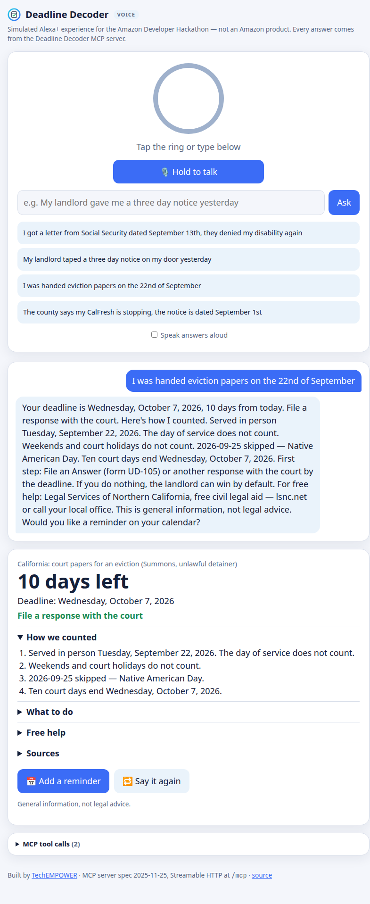

# Deadline Decoder MCP

**Ask a voice assistant "when is my deadline?" and get the real answer, with the math shown.**

An [MCP](https://modelcontextprotocol.io) server (spec **2025-11-25**, **Streamable HTTP**) that gives Alexa+ and any other MCP-capable assistant exact, cited deadline math for the letters that upend people's lives:

| Letter | Rule |
|---|---|
| Social Security: application denied | 60 days from receipt; receipt presumed 5 days after the notice date; weekend/holiday rollover (20 CFR 404.909, 404.901, 404.3(b)) |
| Social Security: denied again (reconsideration) | same counting, request a hearing (20 CFR 404.933) |
| California 3-day notice to pay rent or quit | 3 **court** days; weekends and judicial holidays excluded (CCP § 1161(2), AB 2343) |
| California eviction court papers (unlawful detainer) | 10 court days to respond (CCP § 1167, AB 2347, eff. 2025) |
| Medi-Cal / CalFresh Notice of Action | 90 days to request a state hearing (W&I Code § 10951) |
| California court papers for a lawsuit (a Summons that isn't an eviction) | 30 days after service; a last day on a weekend or court holiday moves to the next court day (CCP §§ 412.20(a)(3), 12, 12a) |
| A jury summons | **HEDGE**: the summons prints its own date to respond; postpone once or ask to be excused for hardship (CCP § 209; CRC rules 2.1004, 2.1008) |

A bare "summons" or "court papers" is a question, not a guess: *"Is it about an eviction, a lawsuit about money, or jury duty?"*, and `detect_letter` matches the answer among those candidates.

**The model never computes a date.** It calls these tools, and the rules are plain, tested JavaScript, so a deadline can't be hallucinated. Every answer includes a `speech` field written for the ear: spoken dates, no ISO strings, counting steps rewritten to sound natural.

## Tools

| Tool | What it does |
|---|---|
| `list_letter_types` | Every letter kind: its id, family, confidence (SOLID or HEDGE), whether it needs a date, and which date to ask for |
| `detect_letter(text, today?, among?)` | Recognizes a letter from its printed text **or from how people say it** ("my landlord taped a three day notice on my door yesterday") and resolves spoken dates without a year ("September 13th", "the 22nd of September", "yesterday"). When the words fit several kinds it returns `candidates` and a question; call it again with the answer and `among` |
| `compute_deadline(letter_type, notice_date?, today?)` | Deadline, days left, what to do, how it was counted, next steps, free help, legal sources, and a speakable answer. A HEDGE answer says what the deadline usually is and points to the date on the notice; a letter that prints its own date takes no `notice_date` |
| `make_reminder(letter_type, notice_date, today?)` | An `.ics` all-day event with an alert a week before (refuses if the deadline has passed) |

Server instructions tell the assistant to always call `compute_deadline` rather than doing date math itself, and to confirm the date it passes.

## Run

```bash
npm install
npm start                      # MCP at http://127.0.0.1:8766/mcp, simulator at http://127.0.0.1:8766/
npm test                       # 46 tests: rules, dates, the decoder and end-to-end MCP
```

Behind a reverse proxy: `HOST=0.0.0.0 ALLOWED_HOSTS=deadlines.example.org PORT=8766 npm start` (DNS-rebinding protection stays on for the listed hosts).

Try it from any MCP client (Streamable HTTP, `http://127.0.0.1:8766/mcp`), or with the MCP Inspector:

```bash
npx @modelcontextprotocol/inspector   # transport: Streamable HTTP, URL: http://127.0.0.1:8766/mcp
```

## Voice assistant simulator

`public/` is a **simulated Alexa+ experience**: hold to talk (Web Speech API in Chrome) or type; the page calls the MCP server's tools over Streamable HTTP and speaks the answer. A panel shows every MCP tool call and its result. It's a demo harness, not an Amazon product.



## Where the rules come from

`src/rules/dates.js` and `src/rules/rules.js` began as copies of [Deadline Decoder](https://github.com/jphein/deadline-decoder), the web app, by the same author. Since then they have grown here (new letter kinds, rules as data, D.C. holidays), so they no longer match the web app's copy. `src/decoder.js` adds the voice layer (spoken-date parsing, spoken-phrase letter detection, ear-friendly counting steps, days left, reminders); `src/mcp.js` and `src/server.js` add the MCP server. [Deadline Line](https://github.com/jphein/deadline-line) vendors these files.

### Adding a letter kind

The first five rules have hand-written `compute()` functions. Newer ones are data, written with `spec()` in `src/rules/rules.js`:

- `anchor`: the date counted from (`notice`, `served`, `issued`, `mailed`), or `null` when the letter prints its own deadline.
- `count`: `{ days, unit: "calendar" | "court", mail: 0 | 5, roll: "none" | "court" | "federal" | "dc" }`. The roll rule decides what happens when the last day is a weekend or holiday: `court` (CCP §§ 12a, 135), `federal` (20 CFR 404.3(b)), `dc` (26 U.S.C. §§ 6213(a), 7503), or `none`. **When a statute's roll rule isn't certain, use `none`: an early answer is safe, and a late one isn't.**
- `confidence`: `SOLID` when the statute fixes the period and how it's counted; `HEDGE` when the letter itself sets the date or the period varies. A HEDGE answer says "usually" and points to the date on the notice.
- `detect` (printed cues, two needed; `must` and `not` narrow it), `spoken` (how people say it, tried in `SPOKEN_ORDER`), `answers` (a short answer to "which one?"), and `keyterms` (fed to speech-to-text).
- `headline`, `steps`, `help`, `sources`: what to do, who helps for free, and the law, cited.

Every rule gets tests in `tests/rules.test.mjs`, with expected dates worked out independently of this code, and the table test checks that each rule carries the whole schema.

## Limits

California and federal rules only. Eviction deadlines assume personal service (substituted or posted service adds days; the tool says so). Court holidays are verified against the Judicial Council calendar for 2026 and computed from statute for other years, and the answer says which. This is general information, not legal advice.

## License

AGPL-3.0-or-later © 2026 Jeffrey Pine Hein. See [LICENSE](LICENSE). Built for [TechEMPOWER](https://techempower.org).
